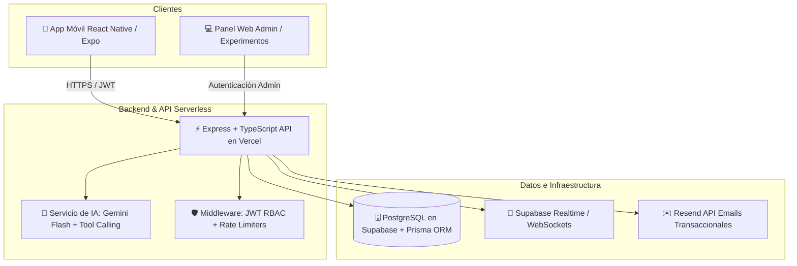

# 🌿 Ayni Care — Guía Maestra del Producto y Sistema

> **Ayni** *(del quechua)*: Principio andino de reciprocidad y solidaridad comunitaria ("hoy por ti, mañana por mí").  
> **Ayni Care** es la plataforma integral de coordinación de cuidado que transforma la sobrecarga solitaria de cuidar a un adulto mayor en una red familiar conectada, eficiente y empática.

---

## 📌 1. Visión General y Propósito del Producto

### 🎯 La Problemática Real en Latinoamérica
En América Latina, más del **85% de los adultos mayores dependientes son cuidados en casa por sus propias familias**. Sin embargo, este cuidado casi siempre recae en una sola persona (generalmente una hija o nuera), provocando:
1. **Síndrome del Cuidador Quemado (*Burnout*):** Estrés extremo, fatiga crónica y sensación de soledad.
2. **Caos de Información:** Indicaciones médicas, recetas y horarios de pastillas dispersos en notas de papel o perdidos en caóticos chats de WhatsApp familiares.
3. **Errores de Medicación Crónica:** Dosis olvidadas, tomas duplicadas o desabastecimiento imprevisto de fármacos esenciales (hipertensión, diabetes, demencia).
4. **Fricciones y Desconfianza Financiera:** Disputas entre hermanos por quién pagó las medicinas, pañales o cuidadores, y falta de rendición de cuentas clara.
5. **Falta de Personal Calificado:** Dificultad para contratar cuidadores formales verificados con reemplazo garantizado ante emergencias.

### 💡 La Propuesta de Valor de Ayni Care
Ayni Care centraliza la **salud, las rutinas diarias, los gastos compartidos y la comunicación** en una sola aplicación móvil colaborativa, complementada con un **Asistente Clínico Inteligente con IA** accesible por voz y texto directamente dentro de la app.

---

## 🏗️ 2. Arquitectura y Stack Tecnológico

- **Frontend Mobile:** React Native + Expo (SDK 52+), TypeScript estricto, NativeWind (Tailwind), Zustand (estado global de sesión), React Query (@tanstack/react-query para cache y sync), Expo SecureStore (almacenamiento encriptado de tokens), Expo Audio (grabación de notas de voz en alta fidelidad).
- **Backend Server:** Node.js, Express, TypeScript, Zod (validación estricta de esquemas), Prisma ORM con PostgreSQL en Supabase. Alojado con arquitectura serverless en Vercel.
- **Inteligencia Artificial Multimodal:** `@google/genai` con cascada de modelos (`gemini-3.6-flash`, `gemini-flash-latest`, `gemini-3.5-flash`), Function Calling autónomo con confirmación *Human-in-the-Loop*, transcripción de notas de voz en base64 y reglas anti-jailbreak.
- **Seguridad e Infraestructura:** Encriptación HTTPS de extremo a extremo, CORS controlado, rate limiting por IP/usuario para IA y endpoints generales, y RBAC (Control de Acceso Basado en Roles).

---

## 📱 3. Módulos y Funcionalidades Clave

### 🏠 A. Pestaña "Resumen" (Dashboard del Día)
- **Semáforo de Bienestar Diario:** Registro rápido de 1 toque del estado del paciente (Ánimo: Excelente/Normal/Decaído; Dolor; Apetito; Descanso).
- **Línea de Tiempo Cronológica:** Visualización unificada de todo lo que debe ocurrir hoy (medicamentos, citas médicas y tareas).
- **Adherencia en Tiempo Real:** Barra de progreso porcentual del cumplimiento de tomas del día (`X de Y dosis tomadas`).
- **Alerta de Stock Crítico:** Aviso visual destacado cuando una medicina tiene 5 pastillas o menos en casa.

### 💊 B. Módulo de Medicamentos (Tratamiento Crónico)
- **Ficha Farmacológica Completa:** Nombre, presentación (pastilla, jarabe, inyección, gotas), dosis precisa, frecuencia y múltiples horarios de toma (ej. 08:00 y 20:00).
- **Registro de Administración en 1 Toque:** Al presionar "Dar dosis", se registra al instante el familiar que la suministró, la hora exacta y se descuenta el stock de manera atómica en la base de datos.
- **Prevención de Sobredosis:** Si una dosis ya fue dada por otro familiar o cuidadora, el botón cambia a *"Listo por hoy"*, evitando confusiones.
- **Validación Comercial Integrada:** Modal interactivo con pantalla de confirmación para solicitar *"Despacho de Farmacia a Domicilio"* con cotización programada antes de que se agote la receta mensual.

### 📋 C. Módulo de Actividades y Tareas de Cuidado
- **Organización de Rutinas:** Baño asistido, control de glucosa y signos vitales, cambio de pañales, curación de escaras o paseos terapéuticos.
- **Asignación por Miembro:** Cada actividad puede asignarse a un hermano específico o a la cuidadora de turno.
- **Trazabilidad Colaborativa:** Notificación y check visual instantáneo para toda la familia cuando la tarea es finalizada.

### 🗓️ D. Módulo de Citas Médicas y Controles
- **Historial y Próximas Citas:** Especialidad médica (Geriatría, Cardiología, Neurología, etc.), doctor tratante, clínica/hospital y ubicación física.
- **Notas de Consulta:** Registro de los cambios de indicaciones emitidos por el médico para que toda la red familiar los conozca de inmediato.

### 💰 E. Módulo de Gastos Compartidos (Finanzas Familiares)
- **Registro con Categorías:** Medicamentos, pañales/insumos, honorarios de enfermería, consultas particulares o alimentos especiales.
- **División Inteligente:** Permite repartir el costo equitativamente entre los aportantes o asignar montos específicos a cada hermano.
- **Control de Saldos y Reembolsos:** Registro transparente de quién pagó y quién adeuda, eliminando las discusiones familiares de dinero.

### 📝 F. Módulo de Bitácora / Notas de Evolución
- **Libro de Novedades Digital:** Registro de incidentes, observaciones de comportamiento o cambios de ánimo con fotos de recetas y comprobantes.

### 🤖 G. Asistente Clínico Inteligente con IA ("Ayni")
- **Entrada Multimodal:** Admite mensajes escritos o notas de voz grabadas directamente desde el micrófono del teléfono.
- **Comprensión de Lenguaje Natural:** Interpreta lenguaje cotidiano de cuidado familiar:  
  * *"Le acabo de dar su Losartán a papá"* ➔ Registra la dosis del medicamento.  
  * *"Gasté 140 soles en la farmacia comprando pañales"* ➔ Registra el gasto dividido.  
  * *"El geriatra programó control el próximo martes a las 11am en la Clínica San Felipe"* ➔ Prepara la cita médica.
- **Protocolo Human-in-the-Loop (`draft_preview`):** Cuando el usuario pide agregar un nuevo evento o medicina, la IA **no lo graba a ciegas**; genera una tarjeta visual interactiva con los datos extraídos para que el usuario verifique y presione *"Confirmar y Guardar"*.
- **Acompañamiento y Sondeo Empático:** Al confirmar una acción, el asistente formula preguntas de descubrimiento clínico y emocional (*"¿Cómo notaste a don Juan hoy?"*, *"Recuerda descansar un poco, ¿cómo te sientes de energía hoy?"*), permitiendo detectar sobrecarga familiar y validar nuevas necesidades.
- **Seguridad y Resiliencia:** Cascada de 6 modelos con fallback automático ante errores 503/429, límite de tokens (`maxOutputTokens: 1200`), rate limiter dedicado (40 consultas / 15 min) y directrices anti-jailbreak.

### 👥 H. Gestión Familiar y Roles (RBAC)
- **Cuidador Principal (`primary_caregiver`):** Administrador del hogar, gestiona finanzas, medicamentos y miembros.
- **Familiar Aportante (`family_member`):** Participa en actividades, visualiza bitácora y colabora en gastos.
- **Cuidador Externo / Pagado (`paid_caregiver`):** Personal contratado; puede registrar signos vitales, actividades y dosis, pero tiene restringido el acceso a finanzas familiares y administración del paciente.
- **Validación Comercial de Agencias:** Modal interactivo con confirmación in-modal para cotizar *"Agencias de Cuidado Formal"* filtrando por turno (noche 12h, día 12h, cama adentro 24/7) y urgencia.

---

## 📊 4. ¿Qué Mide la App y Cómo lo Mide?

Ayni Care es un **motor de métricas clínicas, operativas y de validación de negocio**.

### 🩺 A. Métricas Clínicas y de Calidad del Cuidado
| Métrica | ¿Qué Mide? | ¿Cómo se Mide Técnicamente? | Objetivo |
|---|---|---|---|
| **MAR (Medication Adherence Rate)** | Porcentaje de dosis tomadas en horario vs. programadas. | `(Dosis administradas / Dosis programadas en el periodo) * 100` registradas en la tabla `MedicationLog`. | Evitar descompensaciones clínicas, hospitalizaciones y duplicidad de tomas. |
| **Tiempo de Desfase de Dosis** | Minutos transcurridos entre la hora programada y la hora real de administración. | `timestamp(log.administeredAt) - timestamp(scheduledTime)`. | Detectar si el cuidador está sobrecargado en ciertos horarios del día. |
| **Runway de Stock Farmacéutico** | Días restantes antes de que se agote cada medicina. | `Stock actual / (Tomas diarias * unidades por dosis)`. Se activa alerta cuando el runway es `<= 5 días`. | Automatizar el pedido a domicilio antes de que el paciente se quede sin medicina. |
| **Índice de Cumplimiento de Rutinas** | Eficacia en tareas esenciales (higiene, cambios posturales, hidratación). | `Actividades completadas / Total de actividades agendadas` en `ActivityLog`. | Garantizar la calidad de vida y prevenir complicaciones como escaras o deshidratación. |
| **Semáforo de Bienestar Basal** | Evolución del estado de ánimo, apetito y dolor del adulto mayor. | Escala ordinal (1 a 5) registrada en el check-in matutino y vespertino. | Detectar deterioro cognitivo o físico temprano para alertar al médico. |

### 👨‍👩‍👦 B. Métricas de Dinámica y Carga Familiar
| Métrica | ¿Qué Mide? | ¿Cómo se Mide Técnicamente? | Objetivo |
|---|---|---|---|
| **Task Distribution Score (Distribución de Carga)** | Porcentaje de tareas que ejecuta el cuidador principal vs. otros familiares. | Agrupación de `ActivityLog` por `memberId`. | Visibilizar la inequidad de esfuerzo para fomentar la corresponsabilidad familiar. |
| **Índice de Transparencia de Gastos** | Tiempo promedio de liquidación de cuentas compartidas. | Días transcurridos entre la creación del gasto en `Expense` y el estado `settled`. | Prevenir tensiones familiares y asegurar fondos continuos para el paciente. |
| **Nivel de Involucramiento Familiar** | Frecuencia de lectura y aportes en la bitácora familiar. | Eventos de sesión y comentarios en `Note` por cada familiar. | Mantener a los hermanos que viven lejos enterados y tranquilos. |

### 💼 C. Métricas de Validación de Negocio (Modelos Comerciales)
| Métrica | ¿Qué Mide? | ¿Cómo se Mide Técnicamente? | Objetivo Comercial |
|---|---|---|---|
| **Demanda de Farmacia a Domicilio** | Interés de las familias en comprar recetas crónicas con delivery recurrente. | Evento `commercial_intent` con `intentType: 'pharma_refill'`, guardando medicamento, stock y familia. | Validar la tracción del servicio de reposición farmacéutica B2B2C con farmacias aliadas. |
| **Demanda de Cuidadoras Certificadas** | Necesidad real de contratación de personal externo y turnos requeridos. | Evento `commercial_intent` con `intentType: 'caregiver_agency'`, capturando turno (12h noche, 12h día, 24/7) y urgencia. | Medir volumen de leads calificados para monetizar por comisión/marketplace con agencias. |
| **Engagement del Asistente IA** | Uso de texto vs. notas de voz y ratio de confirmación de borradores. | Conteo de llamadas a `/api/assistant/chat` vs. `/api/assistant/confirm-action`. | Evaluar la retención orgánica que genera la IA y el valor percibido del asistente clínico. |

---

## 📈 5. ¿Con qué Objetivo Estratégico se Mide Todo Esto?

### 1. Para la Familia (Valor Humano)
- **Reducir el burnout del cuidador en al menos un 40%**, distribuyendo tareas y automatizando el seguimiento.
- **Paz mental:** Cualquier hijo, desde su trabajo o desde el extranjero, abre la app y sabe en 3 segundos si su padre tomó sus medicinas y almorzó bien.
- **Cero discusiones de dinero:** Cuentas claras y transparentes para todos los hermanos.

### 2. Para el Sistema de Salud y Médicos (Valor Clínico)
- Los médicos reciben datos objetivos de adherencia y constantes vitales en lugar del típico *"creo que sí se tomó sus pastillas"*.
- Disminución de hospitalizaciones evitables por crisis hipertensivas o descompensaciones diabéticas.

### 3. Para el Modelo de Negocio (Monetización Escalable)
Ayni Care está concebido con un modelo híbrido de alto crecimiento:
1. **SaaS Freemium Familiar:**  
   - *Plan Gratuito:* Funcionalidades esenciales de coordinación para 1 adulto mayor.  
   - *Plan Premium Familiar (Ayni Plus):* IA ilimitada, transcripción avanzada de voz, reportes clínicos en PDF para el geriatra y múltiples pacientes.
2. **Marketplace de Farmacia Recurrente (Comisión por Transacción):**  
   - Las boticas y farmacias aliadas pagan una comisión (10% - 15%) por cada pedido recurrente mensual generado automáticamente por la app antes de que se agote el stock.
3. **Marketplace de Cuidado Formal / Agencias Certificadas:**  
   - Cobro por lead calificado o comisión mensual de intermediación por cada cuidadora o enfermera colocada en el hogar.
4. **B2B con Aseguradoras y EPS:**  
   - Venta de la plataforma a aseguradoras de salud para el monitoreo ambulatorio de pacientes geriátricos, reduciendo el costo siniestral por reingresos a UCI.

---

## 🛡️ 6. Seguridad, Privacidad y Store Compliance

- **Google Play Store & App Store Ready:**
  - Cumplimiento de políticas de eliminación de cuenta permanente (`DELETE /api/auth/delete-account`).
  - Páginas de Términos y Condiciones y Política de Privacidad públicas (`/terminos` y `/privacy-policy`).
  - Permiso exclusivo de micrófono (`RECORD_AUDIO`) solicitado solo al presionar el botón de nota de voz.
- **Aislamiento Multitenant:** Cada consulta a la base de datos está estrictamente filtrada por el `familyId` del usuario autenticado vía JWT.
- **Protección de Costos de IA:** Rate limits dedicados (40 consultas / 15 min), límite de tokens por respuesta (`maxOutputTokens: 1200`) y validación rigurosa con esquemas Zod.

---

## 🚀 7. Resumen de Estado Actual

| Componente | Estado | Detalle |
|---|:---:|---|
| **Aplicación Móvil (React Native Expo)** | 🟢 100% Lista | Flujos completos, confirmaciones visuales in-modal, audio y diseño nativo. |
| **Backend API (Node.js + Supabase)** | 🟢 100% Listo | Rutas REST, RBAC, analítica comercial, endpoints de diagnóstico y rate limiting. |
| **Asistente de IA (Gemini)** | 🟢 100% Listo | Function Calling, Human-in-the-Loop, reglas de seguridad y cascada multimodelo. |
| **Servidor en Vercel (Producción)** | 🟢 100% Verificado | Clave `GEMINI_API_KEY` activa y verificada en vivo (`has_gemini: true`). |
| **Compilación para Tiendas (EAS Build)** | 🟢 Configurado | [eas.json](file:///c:/Ayni%20Care/Ayni%20Care%20Github/apps/mobile/eas.json) apunta a producción con bundle optimizado para Android y iOS. |
